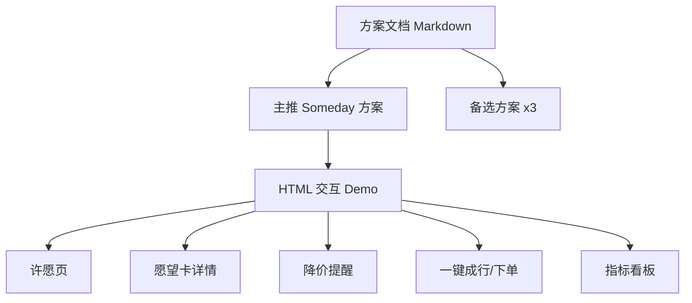

## 产品概述

以携程产品经理视角，产出一份「AI Native 时代重新想象携程」的完整创新方案：主推产品 **Someday「总有一天」旅行愿望单**，并附 3 个备选方案作为面试对话弹药。交付物为一篇可书面提交的严谨方案文档 + 一个可离线点击的移动端 HTML 交互 Demo。

## 核心内容

- **破题与判据**：解释用户此前两个方向（照片归档、旅行社交圈）为何失败，提出「好产品 = 携程独占资产 × 高频场景」的筛选方法论。
- **用户需求**：年轻人旅行决策成本高、灵感与交易割裂；OTA 只在出发前 3 天出现，前 300 天期待期完全空置，导致只有预订时才打开携程。
- **产品创新**：Someday 四步闭环——许愿（一句话/截图/链接/语音 → AI 生成愿望卡）、等待（每日更新入手时机与降价推送）、出发（一键生成可执行行程并复用交易链路）、回来（自动归档旅行记忆）。定位为「期待期陪伴型」高频入口，类比 Steam 愿望单。
- **产品落地（一个月 MVP）**：按周拆分许愿入口、价格监控与推送、行程生成与下单、灰度验证；明确不做社区/UGC/社交/全量城市。
- **效果验证**：北极星指标（许愿用户 30 日回访率）、过程指标、反指标与判死线。
- **备选方案**：「凑一趟」反向 C2M、「拼假规划师」、「此刻」实时交易数据内容，共 3 个。
- **交互 Demo**：手机竖屏原型，可点击演示「许愿 → 愿望卡 → 降价提醒 → 一键成行」主链路，并含指标说明页。

## 技术选型

- 方案文档：Markdown（结构清晰、便于书面提交与后续转 Word/PDF）。
- 交互 Demo：纯静态 HTML + CSS + 原生 JavaScript，单文件自包含，无需构建工具与网络依赖，双击即可在浏览器离线演示。

## 实现方案

### 文档实现

- 采用「破题洞察 → 方法论判据 → 主推方案四段式 → 备选方案 → 风险与边界」结构，严格对齐题目四问：用户需求、产品创新、产品落地、效果验证。
- 引入可量化的指标表述（回访率、转化率、判死线 1.5 倍）以增强「数据感」。
- 用 Steam 愿望单、期待期 300 天、独占资产四象限等易记类比降低评委理解成本。

### Demo 实现

- 手机竖屏容器（约 390px 宽）居中展示，模拟真实 App 手感。
- 页面流程：首页「愿望清单」→ 添加愿望（支持一句话输入/粘贴链接演示）→ 愿望卡详情（目的地、最佳月份、预算、降价进度）→ 降价提醒推送 → 一键生成行程并跳转「下单确认」。
- 用 JS 状态切换模拟多屏交互，不接真实后端，所有数据为演示数据。
- 附「指标看板」页，可视化北极星与过程指标，呼应文档的效果验证部分。

### 性能与可靠性

- 单文件无外部请求，加载快、可离线、可移植。
- 交互采用显式状态机与事件绑定，避免多屏状态耦合；所有价格/日期为演示常量，不涉及敏感数据。

## 架构设计



## 目录结构

```
xiecheng/
├── Someday方案文档.md      # [NEW] 完整方案：破题判据、主推四段式、备选、风险与边界
└── demo/
    └── index.html          # [NEW] 手机竖屏交互原型：愿望清单、许愿、愿望卡、降价提醒、一键成行、指标看板
```

## 设计风格

采用「年轻化旅行 App + 玻璃拟态」风格：以清爽的蓝青渐变为主视觉，配合圆角卡片、柔和阴影与轻量微动效，营造「期待一场旅行」的轻盈氛围。整体为手机竖屏单列布局，顶部状态栏、可滑动的愿望卡流、底部主操作区，贴近真实移动端体验。

## 页面设计

- **愿望清单首页**：顶部品牌区「Someday · 总有一天」，主体为愿望卡列表，每张卡展示目的地、目标月份、预算与降价进度条，右下悬浮「许愿」按钮。
- **许愿页**：底部弹层提供「说一句话 / 粘贴链接」两种入口，提交后展示 AI 解析中动画，随后生成愿望卡。
- **愿望卡详情**：展示目的地大图、最佳出发窗口、预估预算、近 3 年价格走势示意、降价提醒开关。
- **降价提醒页**：推送式卡片呈现「冰岛机票降至近 3 年最低」与最佳预订窗口，突出行动按钮。
- **一键成行/下单确认**：自动生成的 5 天行程摘要（航班/酒店/门票），底部「立即预订」按钮跳转确认态。
- **指标看板页**：以卡片与数字呈现北极星指标、过程指标与判死线，呼应书面方案。

## 视觉与交互

使用渐变背景、毛玻璃卡片、降价时的橙色强调色与进度条动效；按钮与卡片带 hover/点击反馈；页面切换用轻量滑入过渡，保证演示流畅、有「可上手」的质感。